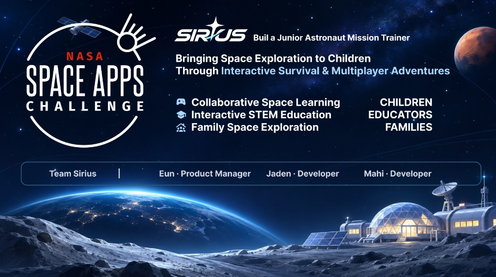
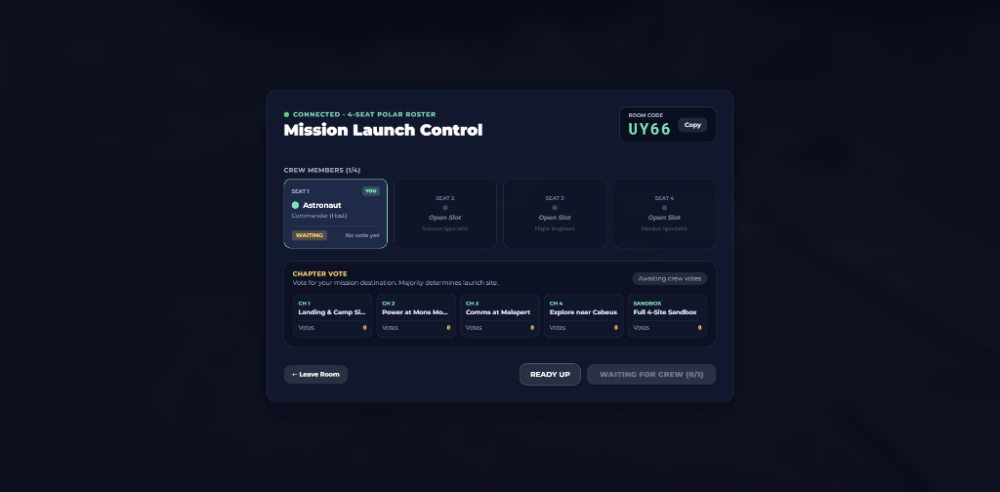
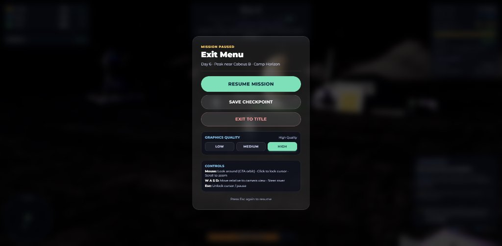
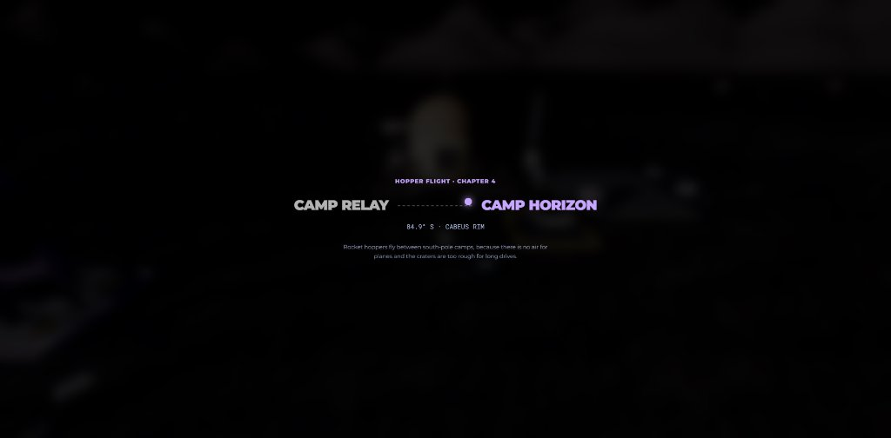
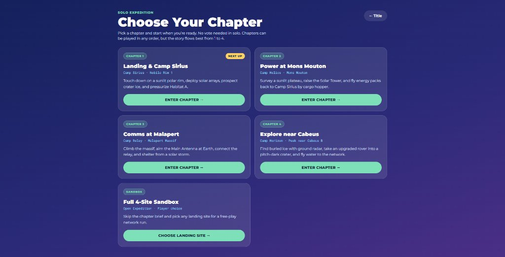
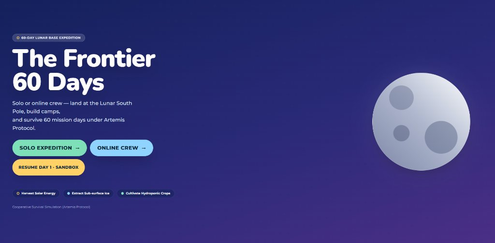
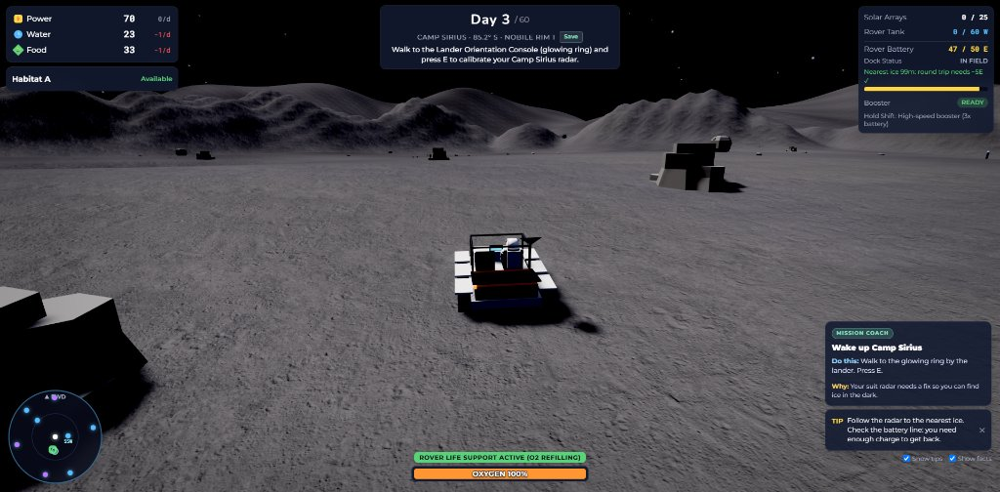
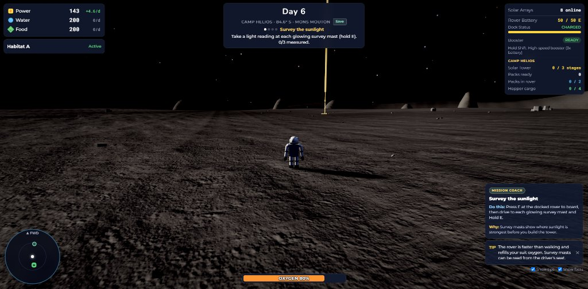
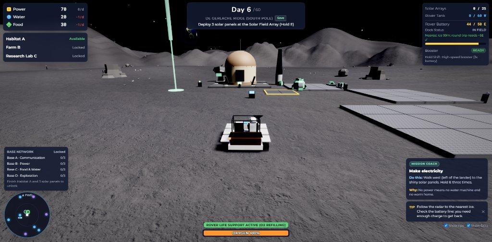

# 🌕 The Frontier: 60 Days

### *Artemis Lunar South Pole Base Survival & Exploration Simulation*



[](https://the-frontier-game.vercel.app/) [](https://the-frontier-colyseus-996f14385e12.herokuapp.com/health)  
[](https://youtu.be/i2C3QRcXBWo?si=6Dxj1w6UWJXKtHRN) [](https://www.figma.com/deck/UZ4Xne3GKSa74aExel3V8g) [](https://www.spaceappschallenge.org/2026/find-a-team/team-sirius1/?tab=project)

---

## 📽️ Project Links & Presentation

- **🎮 Live Playable Game:** [https://the-frontier-game.vercel.app/](https://the-frontier-game.vercel.app/) · **🖥️ Multiplayer Server Status:** [Heroku Online Health Check](https://the-frontier-colyseus-996f14385e12.herokuapp.com/health)
- **🎥 Video Presentation:** [YouTube Video Presentation](https://youtu.be/i2C3QRcXBWo?si=6Dxj1w6UWJXKtHRN)
- **📊 Project Demonstration:** [Figma Presentation Deck](https://www.figma.com/deck/UZ4Xne3GKSa74aExel3V8g)
- **🚀 NASA Space Apps Challenge:** [Team Sirius Project Page](https://www.spaceappschallenge.org/2026/find-a-team/team-sirius1/?tab=project)

---

## 📸 Gameplay Screenshots

| | |
|:---:|:---:|
| **1. Online Crew & Mission Launch Control**<br/> | **2. In-Mission Pause & Graphics Settings**<br/> |
| **3. Suborbital Hopper Flight**<br/> | **4. Campaign Chapter Selection**<br/> |
| **5. Title Screen**<br/> | **6. Lunar Surface Operations & Rover HUD**<br/> |
| **7. Solar Survey Expedition at Mons Mouton**<br/> | **8. Artemis Base Deployment & Solar Array**<br/> |

---

## 🚀 Overview

**The Frontier: 60 Days** is a 3D lunar survival and exploration game developed for the **NASA Space Apps Challenge**. Grounded in NASA's **Artemis Protocol**, the game puts players in the pressurized boots of lunar pioneers establishing humanity's permanent presence at the **Lunar South Pole**.

Players must survive a grueling **60-mission-day operational window** across four real Artemis candidate landing sites. Balance critical life support reserves (**Energy, Water, Food, Oxygen**), prospect and harvest sub-surface water ice from Permanently Shadowed Regions (PSRs), deploy solar arrays along illuminated crater rims, survive extreme space weather events, and construct a self-sustaining four-camp outpost network.

Playable **Solo** through a 4-chapter narrative campaign, or in **Online Crew** (2–4 player cooperative multiplayer via room codes).

---

## 🔭 NASA Data & Scientific Fidelity

*The Frontier: 60 Days* integrates real-world planetary science, topography, orbital data, and mission design from NASA missions:

### 1. Authentic Artemis III Candidate Landing Regions
The game models four distinct South Pole regions identified by NASA for human and robotic exploration:
- **Nobile Rim 1 (85.2° S, 36.1° E — Camp Sirius):** High solar illumination rim adjacent to deep, frigid crater interiors.
- **Mons Mouton (84.9° S, 29.8° E — Camp Helios):** A towering flat-topped mountain plateau offering unobstructed grazing sunlight ideal for solar power generation.
- **Malapert Massif (85.9° S, 2.9° E — Camp Relay):** A 5,000-meter peak with near-continuous direct line-of-sight to Earth for critical deep-space telemetry.
- **Cabeus Crater (84.9° S, 35.5° W — Camp Horizon):** A permanently dark cold-trap crater (-200°C) where NASA's **LCROSS** mission confirmed abundant volatile water ice.

### 2. Lunar Physics & Mechanics ($g = 1.62 \text{ m/s}^2$)
- **Authentic Gravity & Inertia:** Pure TypeScript physics engine simulates true lunar surface acceleration ($1.62 \text{ m/s}^2$, approx. 1/6th of Earth). Low gravity enables long, bounding strides and high jumps while drastically reducing regolith traction.
- **6-Wheel Spring-Damper Rover:** Dynamic wheel suspension modeling ground clearance, weight distribution, hill climb angles, and rollover risk when navigating crater walls.
- **Permanent Shadow Pipeline (PSRs):** Permanently Shadowed Regions are rendered using specialized dual-mesh lighting that isolates terrain from direct solar radiation, requiring rover floodlights and base lamps for navigation.

### 3. Space Weather & Environmental Hazards
- **Solar Proton Events (SPEs):** Intense solar particle storms sweep across the pole, degrading solar cell output by 50% and driving up crew life support oxygen demand ($1.5\times$). Astronauts must seek shelter inside Habitat A or the Lander.
- **Micrometeoroid Showers:** High-velocity impacts damage unshielded solar arrays and rover chassis, requiring emergency EVAs for EVA tool repairs.

### 4. Interactive Science Briefs
Embedded within the game loop are daily **Lunar Science Briefs** referencing **NASA Lunar Reconnaissance Orbiter (LRO)** and **VIPER** mission data. Each brief compares the game's mechanics with real-world lunar science (e.g., regolith composition, solar grazing angles, ice harvesting).

---

## 🎮 Game Modes & Chapters

### 📖 Solo Expedition: 4-Chapter Campaign
Experience humanity's step-by-step colonization of the South Pole:

| Chapter | Location | Objectives & Core Science |
|---------|----------|---------------------------|
| **Ch. 1: Landing & Camp Sirius** | Nobile Rim 1 | Land at Artemis candidate site, deploy solar arrays, extract crater ice, pressurize and cycle Habitat A airlock. |
| **Ch. 2: Power at Mons Mouton** | Mons Mouton | Survey polar sunlight, erect the Solar Tower, and haul high-capacity energy packs by rover. |
| **Ch. 3: Comms at Malapert Massif** | Malapert Massif | Scale the 5 km massif, align the high-gain parabolic antenna with Earth telemetry, and shelter before a solar storm hits. |
| **Ch. 4: Water & Darkness at Cabeus** | Cabeus Crater | Venture into perpetual shadow under floodlights, mine volatile ice, and dock with the base water refinery. |

### 👥 Online Crew (2–4 Players)
- Instant room creation and joining using **4-character room codes**.
- Authoritative state synchronization powered by **Colyseus** and WebSockets.
- Real-time multiplayer rover driving, EVA movements, synchronized module construction, and cooperative chapter voting.

---

## 🕹️ Controls

| Action | Primary Key | Secondary Key |
|--------|-------------|---------------|
| **Move / Steer Rover** | `W`, `A`, `S`, `D` | `Arrow Keys` |
| **Look / Turn Camera** | `Mouse Movement` | `Q` / `E` (when not interacting) |
| **Interact / Harvest / Enter** | `E` (Press / Hold) | — |
| **Enter / Exit Rover & Repair** | `R` (Press / Hold) | — |
| **Jump / Step Away** | `Spacebar` | — |
| **Sprint / Rover Speed Boost** | `Shift` (Hold) | — |
| **Pause / Close Modal** | `Esc` | — |

---

## 🛠️ Technology Stack

- **Game Engine & Rendering:** [PlayCanvas 2.24](https://playcanvas.com/) (WebGL 3D engine, custom shaders, dynamic lighting, shadow maps)
- **Web Frontend:** [React 19](https://react.dev/), [TanStack Start](https://tanstack.com/start), [TanStack Router](https://tanstack.com/router), [Vite 8](https://vitejs.dev/)
- **Styling & UI:** [Tailwind CSS v4](https://tailwindcss.com/), Radix UI, Lucide Icons
- **Physics & Simulation:** Pure TypeScript physics engine (`lunarPhysics.ts`), seeded mulberry32 deterministic simulation (`rules.ts`)
- **Audio & Speech:** Web Audio API procedural synthesizer + Web Speech Synthesis API
- **Multiplayer Backend:** [Node.js](https://nodejs.org/), [Express](https://expressjs.com/), [Colyseus 0.15](https://colyseus.io/) (WebSocket Transport)
- **Deployment & Cloud:** 
  - Frontend hosted on **Vercel** (`https://the-frontier-game.vercel.app/`)
  - Multiplayer server hosted on **Heroku** (`https://the-frontier-colyseus-996f14385e12.herokuapp.com/`)

---

## 💻 Local Setup & Execution

### Prerequisites
- **Node.js** >= 20.0.0
- **npm** >= 10.0.0

### 1. Clone the Repository
```bash
git clone https://github.com/MuhtasimMahim/The-frontier-Space-Game-Team-Sirius.git
cd The-frontier-Space-Game-Team-Sirius
```

### 2. Run the Frontend
```bash
npm install
npm run dev
```
Open [http://localhost:8080](http://localhost:8080) in your browser.

### 3. Run the Multiplayer Server (Optional for local testing)
In a separate terminal:
```bash
npm run server:install
npm run server:start
```
The Colyseus game server will listen on `ws://localhost:2567`. Health check available at `http://localhost:2567/health`.

### 4. Run Test Suite
```bash
npm run test         # Vitest unit & integration test suite (119 tests)
npm run typecheck    # TypeScript compiler check
npm run build        # Production build verification
```

---

## 📜 Credits & Attributions

- **NASA Visible Earth:** [Blue Marble](https://visibleearth.nasa.gov/collection/1484/blue-marble) Earth imagery (Public Domain).
- **Poly Haven:** [Moon 02](https://polyhaven.com/a/moon_02) lunar regolith surface textures (CC0 1.0).
- **Kenney:** [Space Kit 2.0](https://kenney.nl/assets/space-kit) 3D base structures, hangars, and machinery (CC0 1.0).
- **NASA Lunar Data:** Topographical and scientific reference data from the **Lunar Reconnaissance Orbiter (LRO)**, **LCROSS**, and **Artemis III Candidate Regions**.

---

<div align="center">
  <b>Developed by Team Sirius for the NASA Space Apps Challenge 2026</b><br/>
  <i>Humanity returns to the Moon — and this time, we are staying.</i>
</div>
